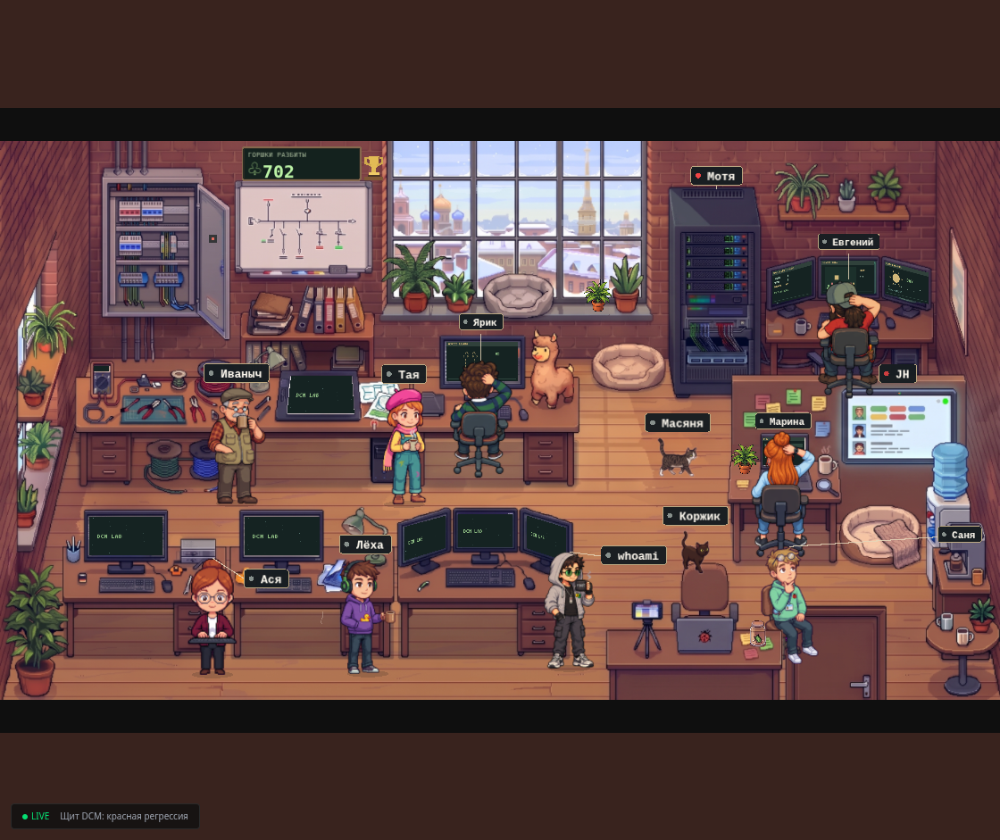
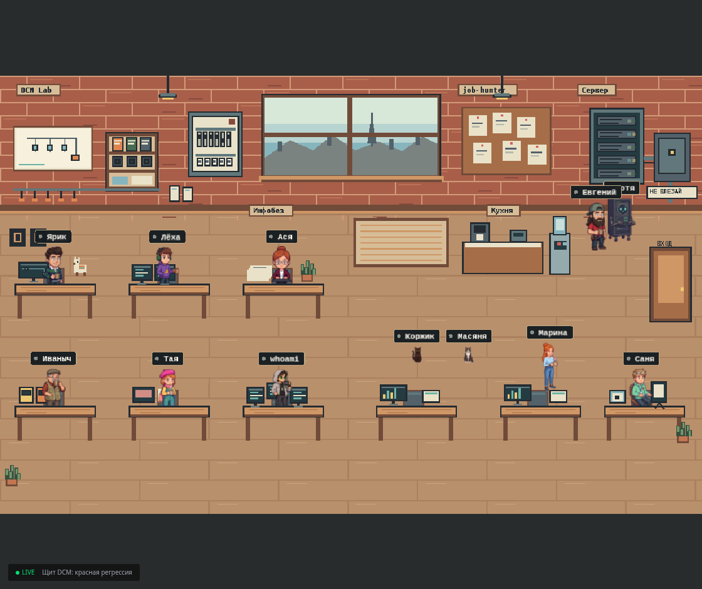
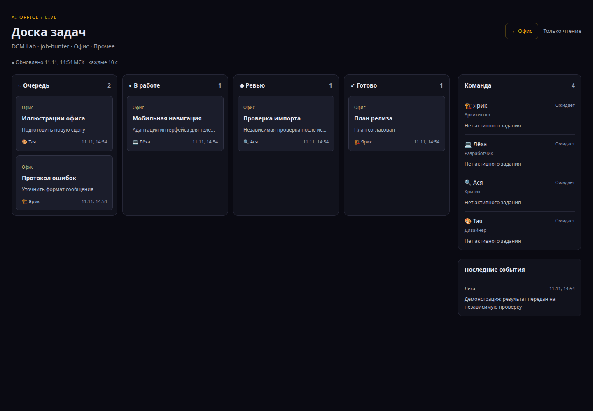

# AI Office

Живой визуальный офис для команды AI-агентов: видно, кто пишет код, кто проверяет результат, какая задача выполняется и где работа остановилась. Рабочий снимок проекта на 11 ноября 2026 года.



## Что делает

- **Показывает команду в офисе.** Персонажи со своими рабочими местами, состояниями, перемещениями и анимациями. Темы: арт-лофт, лофт-мастерская и киберофис; несколько способов отрисовки героев.
- **Собирает наблюдаемую активность.** Python-мост читает локальные процессы Codex/Claude, журналы очередей и Git. Для DCM различает линии Щита и Сметы; для Job Hunter — разработку и плановые поиски.
- **Ведёт доску задач.** Очередь, работа, ревью, завершение и предупреждения; исполнитель, описание и техническая причина показаны отдельно.
- **Обновляет интерфейс вживую.** WebSocket и периодический опрос API; лента событий, карточки агентов и статистика проектов.
- **Объясняет остановки через Пульт.** Стадия работы, ожидание модели, блокер, необходимость решения владельца и примерное время этапа. Авторизованное управление поддерживает запуск, паузу после круга, подтверждение ревью и повтор — через отдельный DCM backend.
- **Добавляет жизнь между задачами.** Коты, кофе, пицца, совещания, ночные сцены, интерактивные предметы и мини-события. Анимации дополняют статусы, а не заменяют данные наблюдения.



## Экраны

| Адрес | Назначение |
| --- | --- |
| `/office/stream` | Панорама офиса, агенты, события и статистика |
| `/office/board` | Доска задач |
| `/office/admin` | Администрирование, требует входа |
| `/pult` | Состояние и управление очередями DCM; нужен отдельный backend |

Скриншоты показывают текущие компоненты интерфейса. Доска ниже использует демонстрационные данные; на панорамах не показана служебная лента задач.



## Как устроено

**Next.js 15 + React 19 + TypeScript**, PixiJS 8 для сцены, Zustand для состояния, SQLite/better-sqlite3 + Drizzle для данных, отдельный Node.js WebSocket-сервис. Интеграция наблюдения и сторож очередей написаны на Python 3.

```text
Codex / Claude / журналы / Git
              │ чтение
              ▼
    Python office-bridge ───► SQLite
                                │
                         Next.js API + WebSocket
                                │
                         офис / доска / статистика

Пульт ──► отдельный ops backend ──► разрешённые действия очередей
```

Мост наблюдения сам не запускает задачи проектов. Управляющая часть Пульта отделена от него. Завершившийся процесс не означает независимую приёмку продукта.

## Локальный запуск

Нужны Node.js 22, npm и инструменты сборки нативного `better-sqlite3`. Для интеграции — Python 3; runtime моста использует стандартную библиотеку.

```bash
npm ci
cp config/office.example.json config/office.json
cp .env.example .env.local
# Укажите собственный JWT_SECRET в .env.local.
npm run db:migrate
npm run dev
```

Офис: `http://localhost:3000/office/stream`. Клиент на порту 3000 подключается к WebSocket на 3101; на других портах ожидает проксирование `/mcws` с того же адреса. В другом терминале:

```bash
node worker/ws-server.js
```

Для чистой установки без моста база изначально пустая. Команда `node --env-file=.env.local --import tsx scripts/init-demo.ts` создаёт демонстрационную команду и задачи. Это отдельная команда для новой базы; живые данные не поставляются. Для чтения офиса в localhost/LAN вход не требуется; запись API и админка требуют JWT. Демо не создаёт администратора.

Для собственной конфигурации измените `config/office.json`. Персонажи текущей сцены и правила распознавания процессов настроены под конкретную команду DCM/JH: это рабочий проект, а не полностью универсальный конструктор.

## Подключение к рабочим проектам

Код и тесты моста: [`integrations/office-bridge`](integrations/office-bridge). Подробности: [руководство моста](integrations/office-bridge/README.md).

- Задайте свои пути к проектам и очередям в `config/office-projects.json` по [примеру](config/office-projects.example.json).
- При запуске моста укажите `--db`, `--work-root` и `--projects-config`. Без явного пути исходная интеграция рассчитывает на соседние каталоги `ai-office` и `office-bridge` внутри рабочего окружения.
- Правила распознавания, systemd-шаблоны и DCM ops backend содержат пути исходной установки. Адаптируйте их перед использованием; не устанавливайте units вслепую.
- Для `/pult` нужны настроенные `ops_watch.py`/`ops_api.py`, приватный транспортный ключ и конфигурация авторизации. Секреты и действующие конфиги в репозиторий не входят.

## Проверки

```bash
npm test
npx tsc --noEmit
python3 -m pytest -q integrations/office-bridge/tests
```

Продакшен-сборка: `npm run build`, затем `npm start`. Собирать нужно в отдельном каталоге, если этот же экземпляр уже обслуживает пользователей: Next.js заменяет `.next` при сборке. Старые Docker/PM2/SSH-скрипты сохранены как исходные заготовки; основной описанный путь — локальный Node.js + отдельный WS.

## Состав публикации

Это чистый снимок текущего кода с новой историей. Здесь нет рабочей SQLite, пользователей, паролей, сессий, Telegram-ключей, журналов проектов и приватной конфигурации. Пустую БД создают миграции. Встроенный fallback JWT и старый `seed-db.ts` предназначены для разработки: для своей установки задайте секрет и не используйте старые демонстрационные пароли.

Проект развивает AI Office Constructor / OpenClaw Content Factory. Исходная атрибуция сохранена в конфигурации-примере и исходниках. 

Для Python-проверок и проверки пикселей установите `python3 -m pip install -r requirements-test.txt`. Два JSON в `output/` — сохранённые отчёты проверки рисунков, необходимые тестам без исходных больших арт-листов; это не журналы рабочих проектов.

Результаты проверок и известное ограничение production-сборки: [docs/VALIDATION.md](docs/VALIDATION.md). В исходной ESLint-конфигурации найден несовместимый импорт; компиляция приложения и отдельная проверка TypeScript проходят, полный production-build пока не подтверждён.
